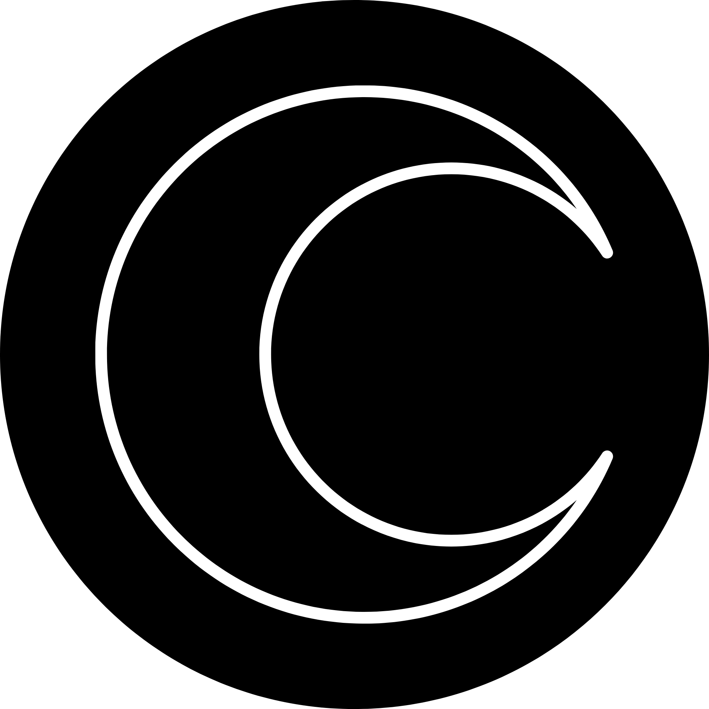
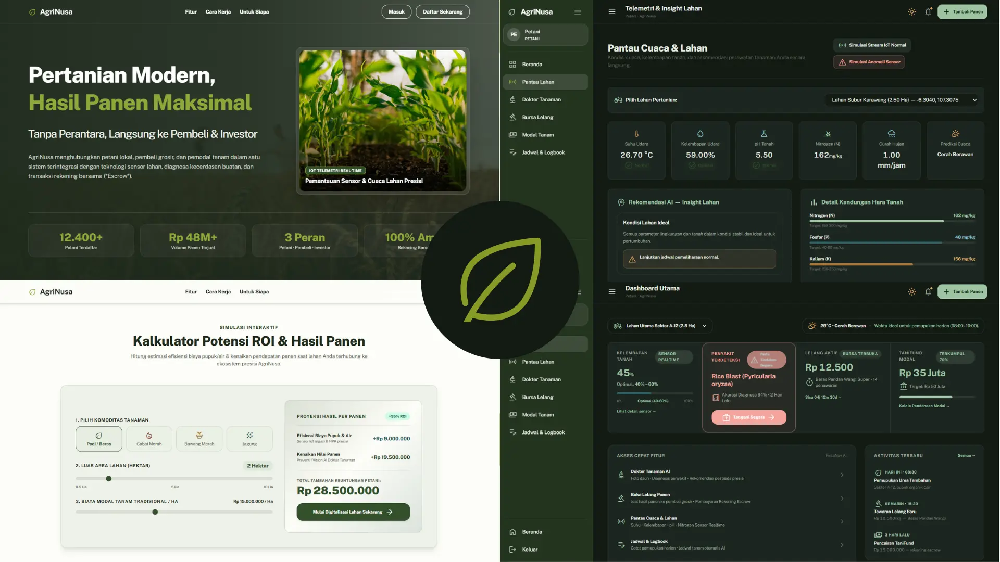
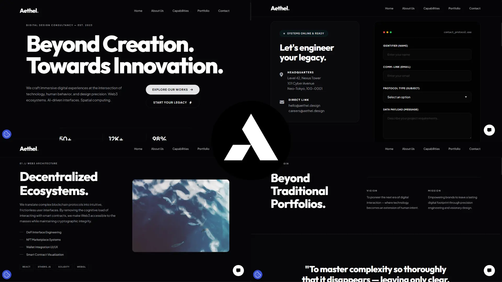
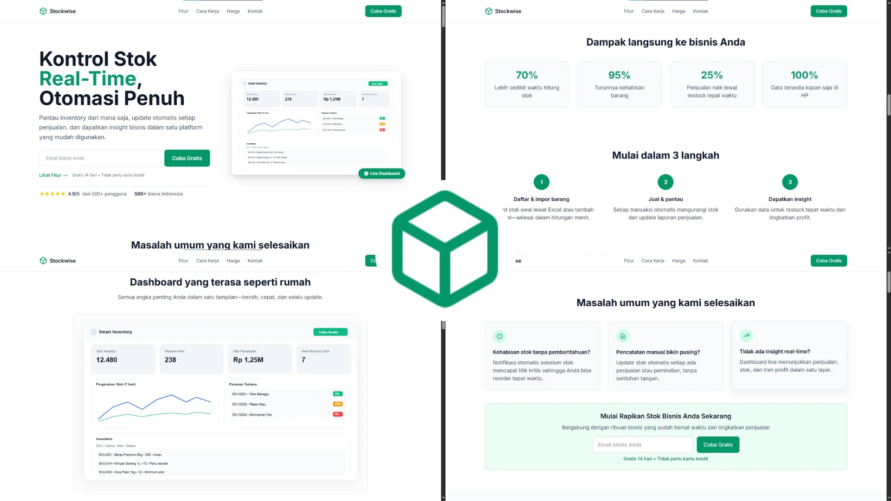
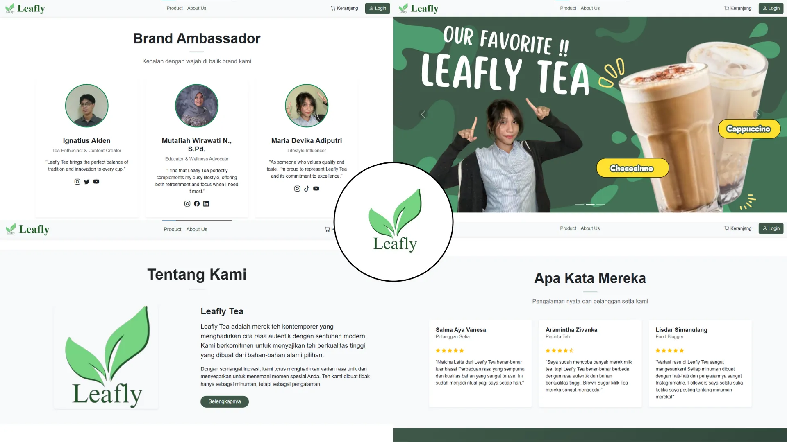

<div align="center">

  <a href="https://abigaildev.my.id/" target="_blank">
    
  </a>

  # Benedictus Abigail Triwiyatno
  ### High-Craft Web Engineering, Editorial Frontend & SaaS Solutions

  <!-- Dynamic Animated Typing Banner -->
  <a href="https://abigaildev.my.id/">
    
  </a>

  <br/><br/>

  <!-- High-Craft Badges -->
  [](https://abigaildev.my.id/)
  [](https://astro.build/)
  [](https://react.dev/)
  [](https://tailwindcss.com/)
  [](https://www.typescriptlang.org/)
  [](https://abigaildev.my.id/)
  [](https://www.w3.org/WAI/standards-guidelines/wcag/)
  [](https://abigaildev.my.id/)

  <br/>

  <!-- Repository Health & Social Indicators -->
  [](https://github.com/AbiSulfur/Portofolio/stargazers)
  [](https://github.com/AbiSulfur/Portofolio/network/members)
  [](https://github.com/AbiSulfur/Portofolio/commits/main)
  [](LICENSE)

  <p align="center">
    <strong>Portofolio web modern dengan pendekatan anti-AI-slop design, layout editorial bergaya Framer, dan motion buttery-smooth berbasis Astro Islands Architecture.</strong>
  </p>

  <p align="center">
    <a href="https://abigaildev.my.id/" target="_blank">🌐 <strong>Jelajahi Live Demo</strong></a> •
    <a href="#-tentang-proyek">📖 <strong>Tentang</strong></a> •
    <a href="#-fitur-unggulan">✨ <strong>Fitur Utama</strong></a> •
    <a href="#-showcase-karya-unggulan">💼 <strong>Showcase</strong></a> •
    <a href="#-tech-stack--tooling">🛠️ <strong>Tech Stack</strong></a> •
    <a href="#-arsitektur-desain--motion">🎨 <strong>Desain & Motion</strong></a> •
    <a href="#-panduan-instalasi--menjalankan-lokal">📦 <strong>Instalasi</strong></a> •
    <a href="#-kontak--kolaborasi">📞 <strong>Kontak</strong></a>
  </p>

</div>

---

## 🌟 Tentang Proyek

Website portofolio ini dirancang khusus dari awal untuk merepresentasikan keahlian **Benedictus Abigail Triwiyatno**, mahasiswa Software Engineering dan freelance web engineer di Indonesia yang berfokus pada pembuatan website B2B, landing page SaaS dengan konversi tinggi, dan aplikasi web modern.

Dibangun melalui migrasi arsitektur dari Next.js ke **Astro v7 + React 19 + Tailwind CSS v4**, portofolio ini mengedepankan performa statis instan, zero unnecessary JavaScript overhead, tipografi berkarakter kuat, dan interaksi mikro yang dinamis namun tetap mematuhi standar aksesibilitas tertinggi.

<div align="center">
  <a href="https://skillicons.dev">
    
  </a>
</div>

---

## 🚀 Fitur Unggulan

- **📂 Pinned Services Folder Stack**: Tumpukan 3 kartu layanan interaktif (`[01]`, `[02]`, `[03]`) dengan tab spacing seragam (76px desktop, 56px mobile) yang mengunci rapi seperti map folder fisik saat discroll, dan keluar bersamaan sebagai satu kesatuan.
- **🌐 Dual-Language Switcher (EN / ID)**: Pergantian bahasa instan (English dan Bahasa Indonesia) berbasis client-side context tanpa perlu reload halaman.
- **🌊 Buttery-Smooth Motion (Lenis + Framer Motion)**: Scroll halus terakselerasi hardware dengan easing expo kustom, efek magnetic pada tombol CTA, dan interaksi kursor dinamis.
- **🎨 Anti-AI-Slop Visual Identity**:
  - Palet warna 60-30-10 terkurasi: Warm Off-White (`#FAFAF7`), Deep Dark Ink (`#0B0B0C`), aksen disruptif Electric Lime (`#C8FF3D`), dan Tailored Blue (`#5B6BFF`).
  - Tipografi self-hosted tanpa font generik: *Bricolage Grotesque* untuk headline editorial dan *DM Mono* untuk aksen teknis.
- **♿ Standar Aksesibilitas WCAG 2.2 AA**:
  - Rasio kontras teks minimum 4.5:1 pada semua mode dan elemen antarmuka.
  - Skip-to-content landmark untuk navigasi keyboard pengguna disabilitas visual/motorik.
  - Fallback penuh `prefers-reduced-motion` untuk pengguna yang sensitif terhadap animasi gerak.
  - Skor Audit Dev Toolbar 100% bersih (0 Accessibility warnings, 0 Performance issues).
- **💼 Showcase Proyek Kurasi**: Kartu proyek interaktif dengan outcome berbasis solusi bisnis nyata, tag teknologi, link repo GitHub, dan tombol live demo.
- **📈 Timeline Alur Kerja Interaktif**: Tahapan pengerjaan 3 fase dengan indikator progres garis SVG yang menyala dinamis mengikuti scroll halaman.

---

## 💼 Showcase Karya Unggulan

Portofolio ini mengkurasi sejumlah proyek pilihan dengan penekanan pada penyelesaian masalah nyata dan dampak bisnis:

| Proyek & Stack | Kategori | Pratinjau Tampilan | Sorotan & Dampak Bisnis | Tautan |
| :--- | :---: | :---: | :--- | :---: |
| **AgriNusa**<br/>`Laravel 11`<br/>`Livewire 3`<br/>`Alpine.js`<br/>`Tailwind CSS`<br/>`MySQL` | **Full Stack** |  | Platform smart farming dan agribisnis terintegrasi dengan IoT, AI, dan P2P Lending Escrow untuk mengurangi risiko gagal panen dan memotong rantai distribusi yang merugikan. | [GitHub Repo](https://github.com/SukaMCD/Agrinusa) |
| **Aethel**<br/>`HTML5`<br/>`Vanilla CSS3`<br/>`Vanilla JS` | **Frontend** |  | Situs profil perusahaan futuristik yang memecahkan masalah kesenjangan kredibilitas digital agensi teknologi, menerapkan Human-First Engineering untuk meminimalisir hambatan kognitif. | [Live Demo](https://abigaildev.vercel.app/)<br/>•<br/>[GitHub Repo](https://github.com/AbiSulfur/Aethel) |
| **Stockwise SaaS**<br/>`Tailwind CSS`<br/>`JavaScript`<br/>`HTML5` | **Frontend** |  | Landing page SaaS profesional yang cepat dan optimal untuk SEO, dirancang khusus untuk mengumpulkan pendaftaran awal sebelum peluncuran resmi produk. | [GitHub Repo](https://github.com/AbiSulfur/Stockwise) |
| **Leafly Tea**<br/>`PHP`<br/>`MySQL`<br/>`JavaScript`<br/>`Bootstrap` | **Full Stack** |  | Sistem e-commerce terintegrasi yang mendigitalisasi proses penjualan tradisional untuk menekan biaya operasional dan membuka saluran pendapatan ritel 24/7. | [Live Demo](https://leaflytea.com)<br/>•<br/>[GitHub Repo](https://github.com/AbiSulfur/LeaflyTea) |

---

## 🛠️ Tech Stack & Tooling

<div align="center">

| Lapisan Arsitektur | Teknologi Pilihan | Peran & Keunggulan |
| :--- | :--- | :--- |
| **SSG Framework** | **[Astro v7.3+](https://astro.build/)** | Islands Architecture, HTML-first output, zero baseline JavaScript |
| **Component Islands** | **[React 19.2](https://react.dev/)** | Hydration selektif (`client:load`) hanya pada modul interaktif |
| **CSS Engine** | **[Tailwind CSS v4](https://tailwindcss.com/)** | Lightning CSS engine, `@theme` token direct integration, fluid typography |
| **Choreography Motion** | **[Framer Motion v14](https://motion.dev/)** | Transformasi scroll-linked berbasis viewport numerik dan spring transitions |
| **Smooth Scrolling** | **[Lenis](https://lenis.darkroom.engineering/)** | Inertial scroll 60 FPS terakselerasi hardware dengan normalisasi link hash |
| **Type Safety** | **[TypeScript 5](https://www.typescriptlang.org/)** | Strict type definitions di seluruh data proyek, servis, dan i18n |
| **Iconography** | **[Lucide React](https://lucide.dev/)** | Ikon vektor monokrom ringan dengan stroke presisi dan konsisten |
| **Deployment & CDN** | **[Vercel Global Edge](https://vercel.com/)** | `@astrojs/vercel` serverless adapter dengan konfigurasi `vercel.json` |

</div>

---

## 🎨 Arsitektur Desain & Motion

### 1. Palet 60-30-10 & Aksen Disruptif
```
┌────────────────────────────────────────────────────────────────────────┐
│  60% Dominan: Warm Off-White (#FAFAF7)                                 │
│  Latar belakang lembut dengan rasio kontras tinggi dan ramah di mata   │
├────────────────────────────────────────────────────────────────────────┤
│  30% Sekunder: Deep Dark Ink (#0B0B0C)                                 │
│  Kontras visual tegas pada kartu, teks utama, dan navigasi editorial   │
├────────────────────────────────────────────────────────────────────────┤
│  10% Aksen Disruptif: Electric Lime (#C8FF3D) & Tailored Blue (#5B6BFF)│
│  Memecah visual generik pada status badge, tombol CTA, dan hover state │
└────────────────────────────────────────────────────────────────────────┘
```

### 2. Logika Pinned Folder Stack
Komponen `Services.tsx` menggunakan pinned viewport container dengan rumus transformasi numerik:
```
Scroll Down ──>
┌──────────────────────────────────────────────┐
│ [01] Web Development & Architecture          │  <-- Card 1 mengunci pada Y = 0px
├──────────────────────────────────────────────┤
│ [02] UI/UX Design & High-Craft Systems       │  <-- Card 2 mengunci pada Y = 76px
├──────────────────────────────────────────────┤
│ [03] Fullstack Web Solutions                 │  <-- Card 3 mengunci pada Y = 152px
└──────────────────────────────────────────────┘
Ketiga kartu terkunci rapi dengan jarak setara, lalu keluar bersamaan sebagai satu deck!
```

### 3. Kurva Easing Kustom
- **Out Expo**: `cubic-bezier(0.16, 1, 0.3, 1)` untuk reaksi gesit pada interaksi hover tombol dan pembukaan kartu.
- **In-Out Expo**: `cubic-bezier(0.76, 0, 0.24, 1)` untuk transisi halaman dan pergerakan section makro.

---

## 📁 Struktur Direktori

```plaintext
Finale Porto/
├── public/
│   ├── fonts/                 # WOFF2 self-hosted (Bricolage Grotesque & DM Mono)
│   ├── Logo.png               # Brand icon & favicon
│   └── Porto*.webp            # Cover screenshot proyek teroptimasi
├── src/
│   ├── components/
│   │   ├── layout/
│   │   │   └── PortfolioApp.tsx   # Root shell, providers, landmark main
│   │   ├── motion/
│   │   │   ├── CustomCursor.tsx   # Interactive fluid cursor
│   │   │   ├── FadeUp.tsx         # Scroll reveal wrapper
│   │   │   ├── LenisProvider.tsx  # Smooth scrolling context
│   │   │   ├── Magnetic.tsx       # Spring-based magnetic hover
│   │   │   ├── ProcessTimeline.tsx# Line reveal scroll-driven progress
│   │   │   ├── ProjectCardMedia.tsx # Interactive preview with view badge
│   │   │   └── WordReveal.tsx     # Typography word-by-word reveal
│   │   ├── sections/
│   │   │   ├── Navbar.tsx         # Header, status badge, language toggle & CTA
│   │   │   ├── Hero.tsx           # Masked headline, pill badges & marquee
│   │   │   ├── Intro.tsx          # Editorial statement & manifesto
│   │   │   ├── Services.tsx       # Pinned folder stack service deck
│   │   │   ├── Projects.tsx       # Asymmetric 2-column curated works
│   │   │   ├── Process.tsx        # Structured 3-step workflow
│   │   │   ├── About.tsx          # Bio, stats counter & tech expertise chips
│   │   │   ├── Contact.tsx        # High-converting CTA block & direct pills
│   │   │   └── Footer.tsx         # Brand links, social links, legal & copyright
│   │   └── ui/
│   │       ├── Badge.tsx          # Status pulse dot badge
│   │       ├── Button.tsx         # Pill CTA with hover sweep animation
│   │       └── Chip.tsx           # Mono outline technology tags
│   ├── data/                  # Static content data (projects, services, process, site)
│   ├── i18n/                  # Kamus bilingual (en.json, id.json) & I18nProvider
│   ├── layouts/
│   │   └── Layout.astro       # Root HTML document, meta SEO, Open Graph & fonts
│   ├── pages/
│   │   ├── index.astro        # Halaman beranda utama
│   │   ├── privacy.astro      # Kebijakan privasi
│   │   └── terms.astro        # Syarat & ketentuan
│   └── styles/
│       └── globals.css        # Tailwind v4 import, theme tokens, dan utilities
├── astro.config.mjs           # Konfigurasi Astro, React, Vite & Vercel adapter
├── vercel.json                # Konfigurasi override preset framework Vercel
└── package.json               # Dependensi proyek
```

---

## 📦 Panduan Instalasi & Menjalankan Lokal

### Prasyarat
- [Node.js](https://nodejs.org/) versi 20.9.0 atau yang lebih baru
- npm, pnpm, atau yarn

### Langkah-langkah

1. **Clone repository:**
   ```bash
   git clone https://github.com/AbiSulfur/Portofolio.git
   cd Portofolio
   ```

2. **Install dependensi:**
   ```bash
   npm install
   ```

3. **Jalankan development server:**
   ```bash
   npm run dev
   ```
   Buka [http://localhost:4321](http://localhost:4321) di browser kamu untuk melihat hasilnya secara lokal.

4. **Build untuk produksi:**
   ```bash
   npm run build
   ```

5. **Preview hasil build:**
   ```bash
   npm run preview
   ```

---

## 📊 Statistik GitHub Pengembang

<div align="center">
  
  
</div>

<br/>

<div align="center">
  
</div>

---

## ⚡ Performa & Aksesibilitas

Proyek ini dibangun dengan komitmen penuh terhadap kualitas kode dan standar web modern:
- **Lighthouse Performance**: 95+ berkat arsitektur statis Astro dan pemuatan aset teroptimasi.
- **Astro Dev Toolbar Audit**: 0 isu aksesibilitas, 0 isu performa.
- **Zero Layout Shift (CLS)**: Aspek rasio gambar dan kontainer terkunci dengan presisi.
- **Font Self-Hosted**: Font WOFF2 disimpan lokal di `/public/fonts/` tanpa ketergantungan eksternal ke server pihak ketiga.

---

## 📞 Kontak & Kolaborasi

Punya ide proyek, kebutuhan pembuatan website bisnis, atau ingin berdiskusi seputar web engineering? Mari terhubung secara langsung:

<div align="center">

  [](https://abigaildev.my.id/)
  [](https://wa.me/6285770020309)
  [](mailto:mautidur34@gmail.com)
  [](https://www.linkedin.com/in/abigail-dev/)
  [](https://github.com/AbiSulfur)

</div>

<br/>

- **Nama**: Benedictus Abigail Triwiyatno
- **Website**: [abigaildev.my.id](https://abigaildev.my.id/)
- **WhatsApp**: [+62 857-7002-0309](https://wa.me/6285770020309)
- **Email**: [mautidur34@gmail.com](mailto:mautidur34@gmail.com)
- **LinkedIn**: [Benedictus Abi](https://www.linkedin.com/in/abigail-dev/)
- **GitHub**: [@AbiSulfur](https://github.com/AbiSulfur)

---

<div align="center">
  <p>Didesain dan dikembangkan dengan dedikasi tinggi oleh <strong>Benedictus Abigail Triwiyatno</strong>.</p>
  <p>© 2026 Abigail Dev. Seluruh hak cipta dilindungi.</p>
</div>